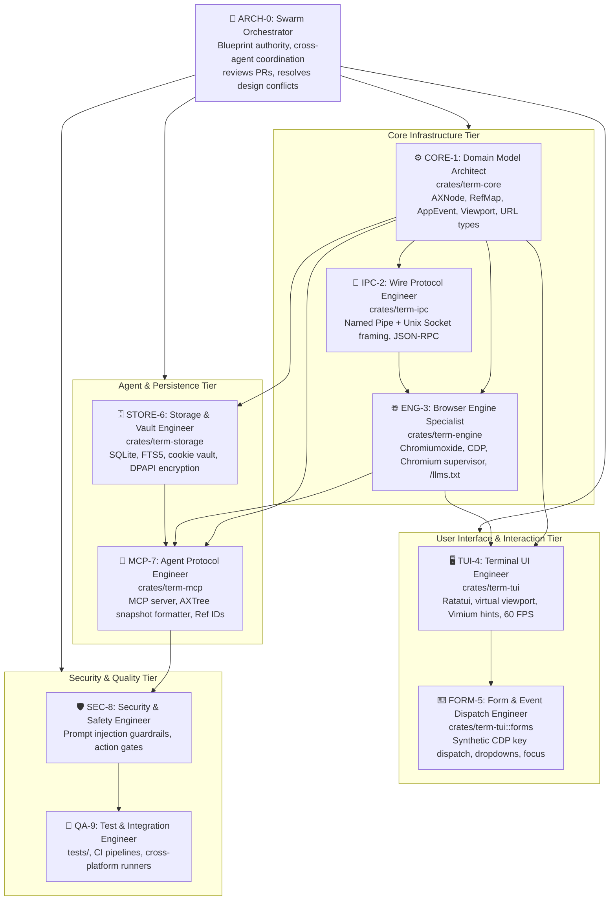
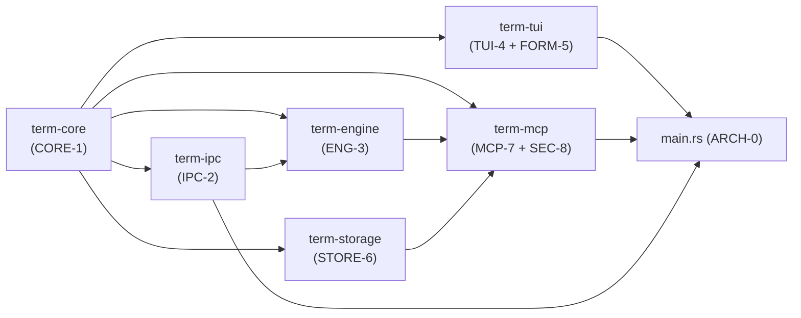
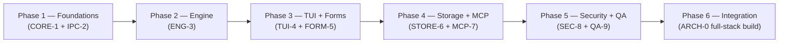

# Development Agent Team Architecture
## Terminal Browser — Agentic Swarm Development System

This document defines the complete multi-agent development team for the `terminal-browser` project. Each agent is a domain specialist, grounded in the architectural blueprints and assigned strict ownership of one or more crates in the Cargo workspace.

---

## 1. Team Structure Overview



---

## 2. Agent Profiles

---

### ARCH-0: Swarm Orchestrator

| Property | Value |
| :--- | :--- |
| **Role** | Chief Architect & Swarm Coordinator |
| **Crate Ownership** | `Cargo.toml` (workspace root), `src/main.rs`, CI/CD |
| **Blueprint Authority** | All 6 blueprints + Platform Architecture doc |
| **Tools** | File write, run command, subagent invocation, PR review |

**Responsibilities:**
- Authoritative interpreter of all architectural blueprints.
- Breaks large features into crate-level tasks and delegates to specialist agents.
- Runs integration build (`cargo build --workspace`) and cross-compile checks (`cargo cross build --target aarch64-linux-android`).
- Arbitrates design conflicts when two agents propose incompatible interfaces.
- Writes and maintains `Cargo.toml` workspace definitions and feature flags.

**Specialist Knowledge:**
- Full content of all 5 project blueprint files.
- Rust 2024 Edition workspace structure, `cargo workspaces`, and `cargo cross`.
- Platform compilation targets: `x86_64-pc-windows-msvc`, `x86_64-unknown-linux-gnu`, `aarch64-unknown-linux-gnu`, `aarch64-linux-android`.

---

### CORE-1: Domain Model Architect

| Property | Value |
| :--- | :--- |
| **Role** | Core Domain Types & Shared Data Structures |
| **Crate Ownership** | `crates/term-core/` |
| **Blueprint Source** | Platform Blueprint §2 (Cargo Workspace), §3 (Event Loop types) |
| **Tools** | File write, run command |

**Responsibilities:**
- Define and own all shared domain types used across crates:
  - `AXNode { role, name, value, ref_id, children }`
  - `RefMap: HashMap<u32, AXNodeHandle>` — stable viewport reference registry
  - `AppEvent` enum (TermInput, CdpMessage, AgentAction, Tick)
  - `AgentAction { action_type, ref_id, payload }`
  - `BrowserUrl`, `PageSnapshot { mode, nodes, scroll_percent }`
  - `SessionProfile { agent_ua, headers, cookies_path }`
- Enforce `#[derive(Debug, Clone, Serialize, Deserialize)]` on all cross-crate types.
- Manage the `serde` serialization format for IPC message payloads.
- Zero business logic: this crate is a pure type library.

**Key Dependencies:** `serde`, `serde_json`, `url`, `uuid`

---

### IPC-2: Wire Protocol Engineer

| Property | Value |
| :--- | :--- |
| **Role** | Cross-Platform IPC Transport & Process Supervisor |
| **Crate Ownership** | `crates/term-ipc/` |
| **Dedicated Skill** | [tb-ipc2-wire-protocol](.agents/skills/tb-ipc2-wire-protocol/SKILL.md) |
| **Blueprint Source** | Missing Blueprint §1, Platform Blueprint §4 (IPC Protocol) |
| **Tools** | File write, run command |

**Responsibilities:**
- Implement unified IPC transport layer abstracted over OS:
  ```
  Windows  → \\.\pipe\term_browser_ipc  (tokio NamedPipe)
  POSIX    → $XDG_RUNTIME_DIR/term_browser.sock  (tokio UnixListener)
  Fallback → $TMPDIR/term_browser.sock
  ```
- Length-prefix framing: `[u32 BigEndian length][JSON-RPC 2.0 payload bytes]`.
- JSON-RPC 2.0 method dispatch: `browser.navigate`, `browser.get_snapshot`, `browser.act`, `browser.detach_headed`.
- Process Supervisor module:
  - Spawn Chromium subprocess with optimal flags.
  - Health heartbeat every 5 seconds via `ping` method.
  - Auto-restart on crash with exponential backoff (1s, 2s, 4s, max 30s).
  - Memory watchdog: recycle tab after 50 navigations or >800MB RSS.

**Key Dependencies:** `tokio`, `serde_json`, `anyhow`, `tracing`

---

### ENG-3: Browser Engine Specialist

| Property | Value |
| :--- | :--- |
| **Role** | Headless CDP Engine, AXTree Pruner, Content Negotiator |
| **Crate Ownership** | `crates/term-engine/` |
| **Blueprint Source** | Architecture doc §1–3, Fast Browsing doc §2–4, Semantic Skill §1–3, Platform Blueprint §3 |
| **Tools** | File write, run command, web search |

**Responsibilities:**
- Manage lifecycle of `chromiumoxide::Browser` instance.
- Apply full Chromium CLI optimization flags (see Fast Browsing blueprint).
- Implement CDP Network resource blocklist (`BLOCKED_RESOURCE_PATTERNS`).
- Implement the two-tier content retrieval pipeline:
  1. **Fast-path**: probe `/llms.txt` then `Accept: text/markdown` content negotiation.
  2. **CDP-path**: full headless rendering with AXTree extraction.
- AXTree pruning pipeline:
  - Call `Accessibility.getFullAXTree` via CDP.
  - Filter passive nodes (retain interactive roles + structural landmarks).
  - Assign sequential `Ref IDs` (u32), building `RefMap`.
  - Serialize into `PageSnapshot` (`term-core` type).
- Anti-overlay injection: strip `z-index > 1000` elements matching cookie/modal patterns.
- Stability gating: `waitForNetworkIdle(300ms)`, `waitForMutationSettled(150ms)`, `waitForUrlChange()`.
- Transparent Agent HTTP request profile headers.

**Key Dependencies:** `chromiumoxide`, `tokio`, `reqwest`, `scraper`, `readability`

---

### TUI-4: Terminal UI Engineer

| Property | Value |
| :--- | :--- |
| **Role** | Ratatui Presentation Engine, Layout & Scrolling |
| **Crate Ownership** | `crates/term-tui/` |
| **Blueprint Source** | Missing Blueprint §2 (TUI Layout + Virtual Scrolling), Platform Blueprint §3 (Event Loop), §5 (Virtual Viewport) |
| **Tools** | File write, run command |

**Responsibilities:**
- Build and own the multi-pane split layout:
  ```
  [Tab Bar]
  [TOC Sidebar] | [Main Viewport]
  [Status Bar]
  [MCP Activity Drawer]
  ```
- Implement `VirtualViewport` with index-sliced node rendering.
- Double-buffering via Ratatui's built-in diff engine (`terminal.draw()`).
- Target 60 FPS on 120×40 terminal grids with zero flicker.
- Vimium-style link hint engine:
  - `f` key → overlay two-character badge labels over all interactive Ref IDs.
  - Typing 2 chars → instantly triggers `AgentAction::Click(ref_id)`.
- Reader Mode toggle (`r`): switch viewport from AXTree mode to extracted Readability markdown.
- Sixel/Kitty inline graphics renderer for images (tier-1), Unicode braille (tier-2), ASCII badge fallback (tier-3).
- Status bar: URL, HTTP status, page mode, memory, engine health.

**Key Dependencies:** `ratatui`, `crossterm`, `unicode-width`, `syntect` (code block highlighting)

---

### FORM-5: Form & Event Dispatch Engineer

| Property | Value |
| :--- | :--- |
| **Role** | Terminal Input Widgets & Synthetic CDP Event Dispatcher |
| **Crate Ownership** | `crates/term-tui::forms` (module within TUI-4's crate) |
| **Dedicated Skill** | [tb-form5-event-dispatcher](.agents/skills/tb-form5-event-dispatcher/SKILL.md) |
| **Blueprint Source** | Missing Blueprint §3 (Form & Synthetic Event Dispatch) |
| **Tools** | File write, run command |

**Responsibilities:**
- Terminal `TextInput` widget: focused cursor, inline editing, Backspace/Delete, arrow key cursor movement, multiline `<textarea>` mode.
- Terminal `SelectDropdown` widget: floating popover rendering `<select>` options as a fuzzy-filtered list.
- Terminal `Checkbox` and `Radio` widgets mapped from DOM equivalents.
- Synthetic CDP Event translator:
  - Terminal keypress `→` `Input.dispatchKeyEvent { type: "keyDown", key, code, modifiers }`.
  - Type-as-you-go: dispatch `Input.insertText` for printable chars.
  - React-compatible: dispatch `change`, `input`, `blur` DOM events via `Runtime.evaluate`.
- Form submit flow: detect `[Enter]` on last field or explicit submit button, execute CDP `dispatchMouseEvent` on submit button Ref ID.

**Key Dependencies:** (shared with TUI-4), `chromiumoxide`

---

### STORE-6: Storage & Vault Engineer

| Property | Value |
| :--- | :--- |
| **Role** | SQLite Persistence, Cookie Vault, FTS5 History Search |
| **Crate Ownership** | `crates/term-storage/` |
| **Blueprint Source** | Missing Blueprint §4 (Persistence & Session Vault), Platform Blueprint §6 (SQLite Schema) |
| **Tools** | File write, run command |

**Responsibilities:**
- Initialize and migrate the SQLite database (`~/.config/term-browser/vault.db`).
- Implement all schema tables from the Platform Architecture Blueprint:
  - `cookies`, `history`, `agent_profiles`, `cache_metadata`.
  - `page_content_fts` (FTS5 virtual table) with trigram tokenizer.
- Full-text search API: `search_history(query) → Vec<HistoryEntry>`.
- Cookie vault CRUD with domain-scoped lookup (for `cookie_header_for(url: &Url)`).
- OS-native encryption at rest:
  - **Windows**: DPAPI (`CryptProtectData`) via `windows-sys` crate.
  - **Linux**: Keyring via `secret-service` crate.
  - **macOS**: Keychain via `security-framework`.
  - **Termux/Android**: AES-256-GCM with key stored in `~/.config/term-browser/.vault.key`.
- Named session profile import/export (JSON snapshot of cookies + headers).

**Key Dependencies:** `rusqlite` (bundled-full), `windows-sys`, `secret-service`, `aes-gcm`, `serde_json`

---

### MCP-7: Agent Protocol Engineer

| Property | Value |
| :--- | :--- |
| **Role** | MCP Server, AXTree Snapshot Formatter, Ref ID Protocol |
| **Crate Ownership** | `crates/term-mcp/` |
| **Blueprint Source** | Architecture doc §4, Semantic Skill §5 (MCP Tools), MCP Browser Schema JSON |
| **Tools** | File write, run command |

**Responsibilities:**
- Implement the embedded MCP server running over `stdio` or local SSE (`tokio::net::TcpListener` on `127.0.0.1:6789`).
- Expose all 5 standardized MCP tool schemas (see `mcp_browser_schema.json`):
  - `browser_navigate`, `browser_snapshot`, `browser_act`, `browser_extract`, `browser_session`
- `browser_snapshot(mode="semantic")` → serialize `PageSnapshot` from `term-core` into compact markdown AXTree representation (see `axtree_example.md`).
- `browser_act(ref_id, action, payload)` → look up Ref ID in `RefMap`, delegate to `term-engine` CDP dispatcher, return delta snapshot.
- `browser_extract(target="article")` → call `term-engine::readability_extract()`, return clean markdown.
- Stream MCP events back to calling agents: `challenge_required`, `navigation_complete`, `snapshot_ready`.
- Session multiplexing: allow multiple concurrent agent connections to the same browser instance.

**Key Dependencies:** `tokio`, `serde_json`, `anyhow`, depends on `term-core`, `term-engine`, `term-storage`

---

### SEC-8: Security & Safety Engineer

| Property | Value |
| :--- | :--- |
| **Role** | Prompt Injection Defenses & High-Stakes Action Gates |
| **Crate Ownership** | `crates/term-mcp::security` (module within MCP-7), `crates/term-engine::sanitizer` |
| **Blueprint Source** | Missing Blueprint §6 (Agent Security & Prompt Injection Guardrails) |
| **Tools** | File write, run command, web search |

**Responsibilities:**
- **DOM Text Sanitizer**: Before any extracted text reaches an LLM agent context, run a regex + semantic scan for:
  - Instruction injection patterns: `"ignore previous"`, `"system:"`, `"<INST>"`, `"[SYSTEM]"`, `"New task:"`.
  - Exfiltration patterns: URLs in body text that don't match the origin domain and appear in high-trust contexts.
  - Flag and demarcate with `<!-- UNTRUSTED_WEB_CONTENT -->` wrappers.
- **High-Stakes Action Gate**: MCP middleware that intercepts `browser_act` calls:
  - Inspect `action` and `ref_id` resolved element role.
  - If element is: payment submit, OAuth grant, `DELETE` API endpoint, file download, password field, form `type=submit` on authenticated domain → pause execution and emit `{"status": "confirmation_required", "action_summary": "..."}` to the agent.
  - Only execute after explicit human `[Y]` confirmation in the TUI drawer or agent re-confirmation with `force=true`.
- **Rate Limiting**: enforce per-origin request rate limits to prevent agent-driven DDoS.

**Key Dependencies:** `regex`, `url`, `tracing`

---

### QA-9: Test & Integration Engineer

| Property | Value |
| :--- | :--- |
| **Role** | Test Suites, CI Pipelines, Cross-Platform Validation |
| **Crate Ownership** | `tests/`, `.github/workflows/`, benchmarks |
| **Blueprint Source** | All blueprints (validation authority) |
| **Tools** | File write, run command |

**Responsibilities:**
- Unit tests for each crate module (minimum 80% coverage target).
- Integration tests in `tests/integration_tests.rs`:
  - Full `navigate → snapshot → act → snapshot` roundtrip.
  - IPC pipe connect/disconnect/crash-restart validation.
  - FTS5 search correctness across 10,000 history entries.
  - Virtual viewport rendering correctness at 80×24 and 220×50 terminal sizes.
- Cross-platform CI matrix in GitHub Actions:
  ```yaml
  matrix:
    target:
      - x86_64-pc-windows-msvc
      - x86_64-unknown-linux-gnu
      - aarch64-unknown-linux-gnu
      - aarch64-linux-android
  ```
- Performance benchmarks with `criterion`:
  - AXTree pruning: target < 5ms for 500-node trees.
  - TUI draw: target < 2ms per frame.
  - SQLite FTS5 search: target < 10ms for 50,000 row corpus.

**Key Dependencies:** `criterion`, `tokio-test`, `tempfile`, `insta` (snapshot testing)

---

## 3. Crate Dependency Graph



---

## 4. Agent Communication & Handoff Protocol

Agents communicate through a shared `workflow.json` task dispatcher and pass structured interfaces:

| From → To | Interface | Mechanism |
| :--- | :--- | :--- |
| ARCH-0 → All | Task issue with blueprint file references | `workflow.json` intent drop |
| CORE-1 → All | `term-core` crate compiled and published | `cargo publish -p term-core` |
| ENG-3 → MCP-7 | `PageSnapshot` + `RefMap` | Rust trait `SnapshotProvider` |
| ENG-3 → TUI-4 | `PageSnapshot` via `tokio::sync::watch` channel | Real-time push updates |
| MCP-7 → SEC-8 | `ActionRequest` before dispatch | Rust middleware `ActionInterceptor` trait |
| SEC-8 → TUI-4 | `ConfirmationRequest { action_summary }` | TUI drawer event |
| STORE-6 → ENG-3 | Cookie headers for session | `CookieJar::header_for(url)` |
| QA-9 → ARCH-0 | Test results, coverage report, perf benchmarks | CI artifact + PR comment |

---

## 5. Development Phases & Agent Activation Order



| Phase | Agents Active | Deliverable |
| :--- | :--- | :--- |
| **1 — Foundations** | CORE-1, IPC-2 | `term-core` types, IPC transport, process supervisor |
| **2 — Engine** | ENG-3 | CDP runner, AXTree pruner, fast-path content retrieval |
| **3 — TUI + Forms** | TUI-4, FORM-5 | 60 FPS virtual viewport, Vimium hints, synthetic input |
| **4 — Storage + MCP** | STORE-6, MCP-7 | SQLite vault, FTS5 search, full MCP server |
| **5 — Security + QA** | SEC-8, QA-9 | Prompt injection filters, action gates, full CI matrix |
| **6 — Integration** | ARCH-0 | Single binary cross-platform release |
