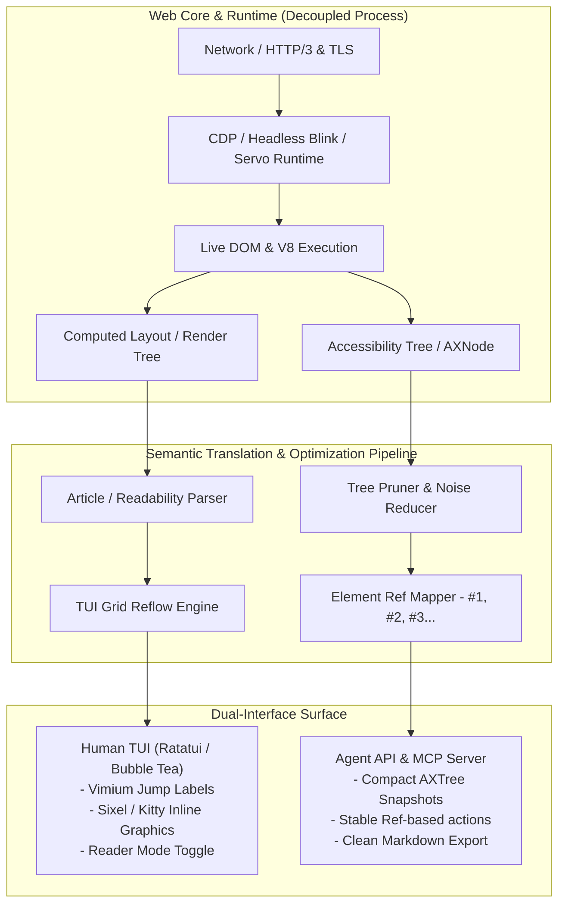
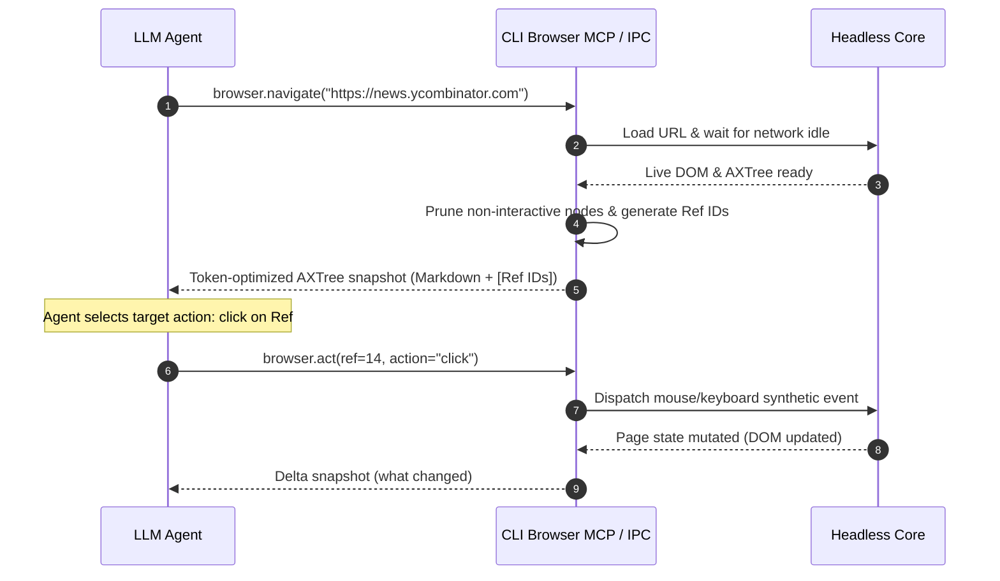

# Architectural Blueprint: Next-Generation Terminal Web Browser

## 1. System Architecture

A modern CLI terminal browser cannot simply be a raw HTML text-dumper (like Lynx) nor a downsampled pixel streaming canvas (like Browsh/Carbonyl). It must balance **modern web compatibility (dynamic JS, SPA, CSS layout)** with **terminal-native ergonomic rendering and agentic operability**.



---

### Core Architectural Subsystems

1. **Decoupled Engine Architecture (Client-Server / Worker Model)**:
   - **Engine Subsystem**: Runs a headless browser instance (Chromium via DevTools Protocol, or an embedded lightweight engine like Servo/WebKit) in a separate sandboxed process.
   - **IPC Bridge**: Communicates over high-speed local IPC (Unix domain sockets or named pipes) using binary serialization (Cap'n Proto or FlatBuffers) rather than slow JSON polling.
   - **TUI Frontend**: Stays responsive at 60 FPS without UI freezes during heavy JavaScript execution, page reflows, or network lag.

2. **Semantic-First Document Representation**:
   - Instead of converting rendered pixels into half-block ANSI characters (`▀▄`), the browser translates the browser's **Accessibility Tree (`AXTree`)** into semantic terminal primitives.
   - Preserves interactive attributes: `Role` (button, link, textbox), `AriaLabel`, `Value`, `Focused`, and hierarchical context.

3. **Multi-Protocol Terminal Graphics Subsystem**:
   - **Tier 1 (Vector/High-Res)**: Kitty Graphics Protocol, iTerm2 inline images, or Sixel graphics for inline images and charts.
   - **Tier 2 (Unicode High-Density)**: Braille patterns (2x4 dots per cell) or Unicode half-blocks (`▀`, `▄`).
   - **Tier 3 (Fallback)**: ASCII placeholders with alt text badges `[IMG: Architecture Diagram]`.

---

## 2. What is Missing in Current Open-Source CLI Browsers?

Existing open-source CLI browsers fall into two extremes, both of which are fundamentally flawed for modern internet usage:

| Category | Projects | Core Strengths | Fatal Flaws |
| :--- | :--- | :--- | :--- |
| **The Old Guard (Text-only)** | `Lynx`, `w3m`, `Links`, `ELinks` | Ultra-fast (<5ms), zero memory, instant terminal text layout. | • **Zero JS/SPA execution**: Modern web apps (Google Docs, Twitter/X, GitHub, Reddit) render blank or error pages.<br/>• No modern auth: OAuth2, SSO, Passkeys, CAPTCHA fail completely.<br/>• No CSS grid/flex understanding: column content stacks linearly out of context. |
| **The Pixel Streamers** | `Browsh`, `Carbonyl` | Renders modern JS and WebGL by streaming pixels to terminal cells. | • **Massive resource overhead**: Runs a full Chromium GPU rendering pipeline just to downsample 1080p to 80x24 cells.<br/>• **Broken text UX**: Selecting text copies distorted ANSI pixels or broken strings.<br/>• Unreadable fonts: Small text becomes illegible block mush.<br/>• Zero agent usability: LLMs cannot reliably read downsampled block art. |
| **TUI Readability Wrappers** | `offpunk`, `chawan`, `frogmouth` | Clean markdown or Gemini/Gopher rendering. | • Lack deep interactive form/auth capabilities.<br/>• Narrow target protocols (Gemini/Markdown-only) or incomplete JS support. |

### Systemic Gaps Across All Existing Projects:
1. **Modal & Cookie Banner Fatigue**: No automatic heuristic to discard cookie consent overlays, paywalls, sticky headers, and newsletter popups that hijack small terminal viewports.
2. **Session Portability**: Inability to seamlessly reuse authenticated sessions, cookies, or profiles from the user's desktop browser (e.g., Chrome/Firefox profiles).
3. **No Native Agent / Machine Interface**: Built exclusively for human visual consumption or basic stdout piping without structured, token-efficient state snapshots.

---

## 3. What Should Next-Gen CLI Browsers Focus On?

### A. Semantic Accessibility over Visual Canvas
Modern web pages are visual sprawl. CLI browsers should prioritize **structural intent**:
- **Automatic "Content Extraction Mode"**: Standardize on algorithms like Trafilatura or Mozilla Readability natively. 90% of CLI browsing is reading articles, documentation, or RFCs.
- **Adaptive Split View**: An interactive document outline / Table of Contents tree on the left panel, with the rendered article/app on the right.

### B. Ergonomic Navigation: Vimium-Style Link Hinting
Navigating links with `Tab` or directional arrows through 500 links is agonizing.
- Pressing `f` overlays two-character mnemonic badges (`[ak]`, `[bl]`, `[cm]`) directly over all interactive elements.
- Typing `bl` instantly triggers or focuses that element.

```
+-----------------------------------------------------------------------+
| [Doc Title] Modern Web Architecture                                   |
|                                                                       |
| By [aa]Jane Doe | Published: Oct 2026 | [ab]Share | [ac]Bookmark       |
|                                                                       |
| 1. Introduction                                                       |
| Distributed systems require robust protocols. For more details, see   |
| the [ad]ZeroMQ Specification or inspect the [ae]Source Code.          |
|                                                                       |
| [af:Search documentation...____________________] [ag:Submit]          |
+-----------------------------------------------------------------------+
(Press 'f' to trigger hints -> type 'ae' to jump directly to Source Code)
```

### C. The "Zero-Bloat" Heuristic Filter
- Integrated declarative ad-blocking (uBlock Origin / Brave adblock engine compiled to WebAssembly).
- Native CSS stripping: automatically strip `position: fixed`, `position: sticky`, modal backdrops, and `overflow: hidden` on body when entering reader or standard terminal mode.

---

## 4. Agentic Integrations: How AI Agents Can Browse Seamlessly

For AI agents to browse the web through a CLI browser without wasting thousands of tokens on raw HTML or hallucinating CSS selectors, the browser must expose a dedicated **Agent Bridge**.



### Essential Agent Integrations

#### 1. Compact Role-Based Semantic Snapshot (AXTree)
Agents should **never** ingest raw HTML. The browser must format the viewport into an ultra-compact token-efficient representation:

```markdown
<!-- Viewport: 1920x1080 | Scroll: 0% -->
[heading:1 "Antigravity Systems Dashboard"]
[navigation]
  - [link #1 "Architecture" href="/arch"]
  - [link #2 "Releases" href="/releases"]
[main]
  [textbox #3 "Search cluster..." value=""]
  [button #4 "Search"]
  [table 2 cols, 2 rows]
    | Node ID | Status |
    | #1001   | [badge "Active"] |
    | #1002   | [button #5 "Restart Node"] |
```

#### 2. Stable Reference Identifiers (`Ref IDs`)
- Instead of asking the agent to generate brittle XPath or CSS selectors (which break on obfuscated Tailwind/React classes), the browser generates dynamic, sequential reference handles (`#1`, `#2`, `#3`).
- Agent calls:
  - `browser.click(ref=4)`
  - `browser.type(ref=3, text="eu-west-1", submit=true)`
  - `browser.select(ref=7, value="option_b")`

#### 3. Native Model Context Protocol (MCP) Server
The CLI browser should run an embedded MCP server over `stdio` or SSE:
- **`browser_navigate(url)`**: Navigates with automatic network-idle detection and anti-bot mitigation.
- **`browser_snapshot(mode="semantic"|"markdown"|"raw")`**: Dumps current state formatted for LLM context windows.
- **`browser_act(ref_id, action, payload)`**: Deterministic interaction engine.
- **`browser_extract_content()`**: Returns clean, citation-linked Markdown with tables, code blocks, and metadata extracted.

#### 4. Shared Session & Cookie Vault (Zero-CAPTCHA Hand-off)
- **Profile Inheritance**: Allow agents to mount the user's default browser profile (e.g., `~/.config/google-chrome/Default` or Firefox profile in read-only mode).
- **Human-in-the-Loop Hand-off**: If a CAPTCHA, Cloudflare turnstile, or 2FA challenge is encountered, the CLI browser triggers a human terminal prompt or pops a minimal local GUI window, waits for human resolution, and automatically hands control back to the agent once the auth cookie is minted.

#### 5. Deterministic Network & DOM Stability Guarantees
- Single-page applications often mutate the DOM asynchronously.
- The browser must expose built-in stability gates: `waitForNetworkIdle(ms)`, `waitForElement(ref_id)`, and `waitForUrlChange()`, eliminating artificial sleep loops in agent reasoning traces.
